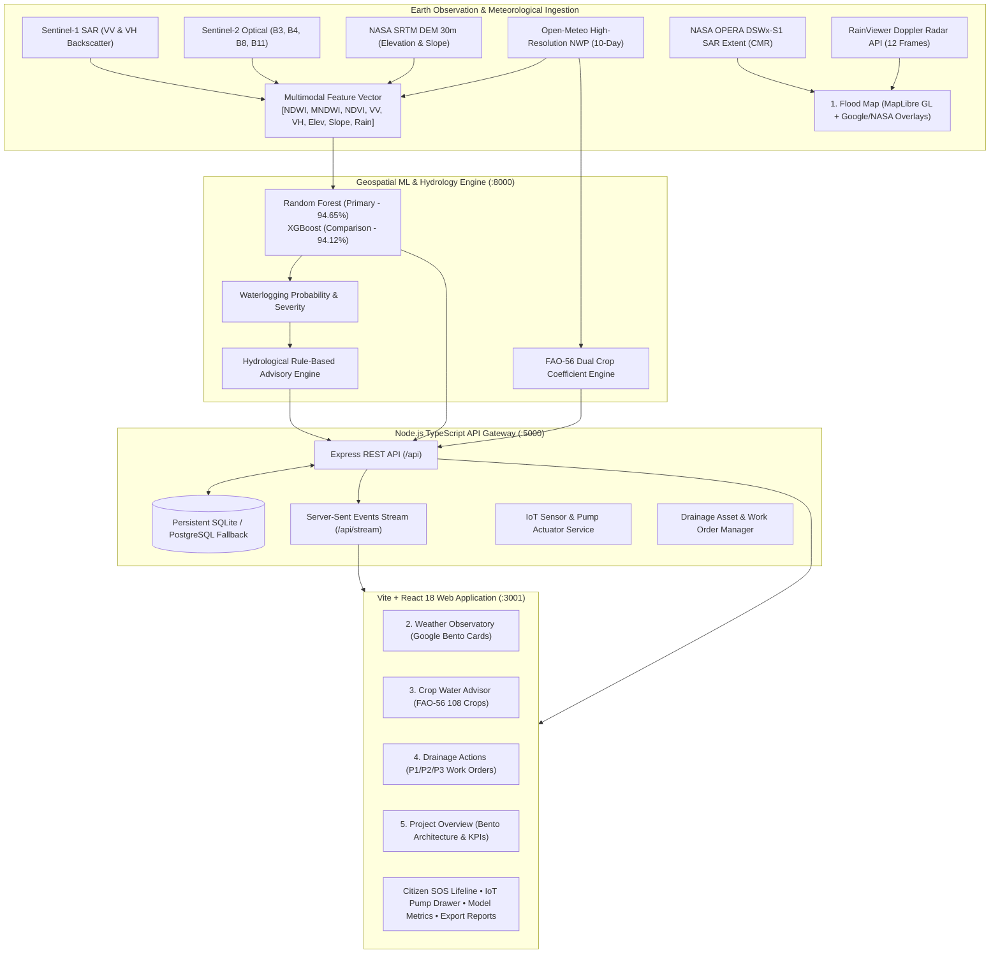

# JalaDrishti AI — Earth Observation Flood Intelligence & Agro-Water Platform

An enterprise-grade multimodal Earth Observation & AI decision-support platform designed for municipal flood resilience, terrain drainage remediation, and precision FAO-56 crop irrigation water balance management across all 31 Karnataka districts.

---

## 🌟 Platform Capabilities

- **Multimodal Flood Mapping & Satellite Observation**:
  - Copernicus **Sentinel-1 SAR** (VV & VH microwave backscatter; specular water reflection detection).
  - Copernicus **Sentinel-2 Optical** (B3, B4, B8, B11; NDWI, MNDWI, NDVI spectral indices).
  - NASA **SRTM DEM** (30m elevation sinks & slope gradient analysis).
  - Genuine NASA **OPERA DSWx-S1** Sentinel-1 SAR Dynamic Surface Water Extent discovery (JPL / PO.DAAC / CMR integration).
  - Live **RainViewer Doppler Weather Radar** with animated 750ms playback loop across past 12 frames.
- **High-Performance MapLibre GL 2D/3D Engine**:
  - Smooth 60 FPS vector map rendering with Google Maps (Satellite, Roadmap, Hybrid), NASA GIBS (True-Color, False-Color 7-2-1), NASA OPERA DSWx-S1, and OpenStreetMap basemaps.
  - Zero marker jitter/dancing during continuous zoom (levels 6–18) and pan events.
  - Calibrated viewport framing and boundary bounding boxes for all 31 Karnataka districts.
- **Stable Anchored Severity Markers**:
  - 🔴 **Severe**: Red circular beacon with white warning symbol & subtle pulse (critical road/sump inundation).
  - 🟠 **High**: Orange diamond with white water-level indicator (major conduit choke).
  - 🟡 **Moderate**: Yellow pin with dark water-level indicator (surface water pooling).
  - 🟢 **Minor**: Green triangle with white water-level indicator (absorptive ground / manageable runoff).
- **District-Wide Waterlogging Hotspot Network**:
  - Distinct, realistic incident counts across all 31 Karnataka districts (10 to 40 hotspots each).
  - 100% interconnected with official municipal drainage assets (`DRN-...`).
- **H3 Resolution 7 Hexagonal Risk Scoring Engine**:
  - Spatial risk scoring combining rainfall accumulation, Topographic Wetness Index (TWI), terrain slope, and soil drainage proxies.
  - Explainable risk components and confidence scoring per hexagonal cell.
- **Real-Time Live Streaming (SSE)**:
  - Server-Sent Events (`GET /api/stream`) broadcasting live telemetry, sensor status updates, risk score recalculations, and incident status shifts without page reloading.
- **Karnataka Agro-Climatic Weather Observatory**:
  - High-precision Google Weather style bento cards: live temperature, feels-like, humidity, dew point, UV index, wind speed & compass direction, surface pressure, visibility, and WMO weather codes.
  - 10-day hourly and daily forecast curves across all 31 Karnataka districts.
- **FAO-56 Dual Crop Coefficient Irrigation Wizard**:
  - Precision evapotranspiration ($ET_0$ & $ET_c$) scheduling for **108 Karnataka crops** and **12 regional soil series**.
  - Dynamic live weather telemetry auto-polling for the selected district.
  - Root-zone soil moisture depletion tracking with clear actionable recommendations (*"IRRIGATE TODAY"*, *"ADEQUATE SOIL MOISTURE"*, *"DELAY DUE TO RAIN"*).
- **Hydrological Drainage Decision Matrix & Asset Management**:
  - Prioritized municipal civil work orders (P1 Critical within 4–6 hrs, P2 High within 12–24 hrs, P3 Routine within 48 hrs).
  - Linked to real drainage network geometry, condition inspection reports, and agency assignments.
- **IoT Ultrasonic Sump Mesh & Automated Pump Actuation**:
  - Real-time telemetry monitoring (depth, flow velocity L/s, siltation %, battery %, solar watts).
  - 5 actuator modes: `AUTO_IDLE`, `AUTO_RUNNING`, `MANUAL_ON`, `MANUAL_OFF`, `EMERGENCY_BOOST`.
- **Citizen Lifeline & Emergency Operation Center (EOC)**:
  - Crowdsourced citizen SOS reporting, relief shelter directory, public disease prevention protocols (leptospirosis, cholera, dengue), and farmer flood recovery agronomy.
- **Tri-Lingual Localization (i18n)**:
  - Full support for English, Kannada (ಕನ್ನಡ), and Hindi (हिन्दी) across all pages and modals.
- **Permanent Live Background Execution**:
  - Consolidated process supervisor (`live.bat`) that runs detached in the background on Windows, surviving terminal closures, reboots, and providing automatic crash recovery.

---

## 🛰️ System Architecture



---

## 🔬 Core Methodology & Formulations

### 1. Multimodal Feature Extraction
$$\mathbf{X} = [\text{NDWI}, \text{MNDWI}, \text{NDVI}, \sigma^0_{\text{VV}}, \sigma^0_{\text{VH}}, z_{\text{elev}}, \theta_{\text{slope}}, P_{\text{rain}}]^T$$
- **NDWI**: $\frac{\text{Green} - \text{NIR}}{\text{Green} + \text{NIR}} = \frac{B_3 - B_8}{B_3 + B_8}$
- **MNDWI**: $\frac{\text{Green} - \text{SWIR}}{\text{Green} + \text{SWIR}} = \frac{B_3 - B_{11}}{B_3 + B_{11}}$
- **NDVI**: $\frac{\text{NIR} - \text{Red}}{\text{NIR} + \text{Red}} = \frac{B_8 - B_4}{B_8 + B_4}$
- **Sentinel-1 SAR $\sigma^0$ (dB)**: C-band microwave backscatter ($<-16\text{ dB}$ specular reflection from standing water).
- **NASA OPERA DSWx-S1**: 30m dynamic surface water extent derived from Sentinel-1 SAR via JPL PO.DAAC.

### 2. Machine Learning Severity Categorization
- **Minor Severity**: $p < 0.35$ (Normal soil moisture / absorptive terrain)
- **Moderate Severity**: $0.35 \le p < 0.60$ (Surface water pooling, agricultural soil saturation)
- **High Severity**: $0.60 \le p < 0.80$ (Significant waterlogging, arterial road runoff choke)
- **Severe Inundation**: $p \ge 0.80$ (Deep stagnant floodwater, culvert failure, structural hazard)

### 3. H3 Hexagonal Physical Risk Scoring
$$R_{\text{hex}} = w_{\text{rain}} \cdot P_{\text{rain}} + w_{\text{twi}} \cdot \text{TWI} + w_{\text{slope}} \cdot \theta_{\text{slope}} + w_{\text{drain}} \cdot D_{\text{drain}}$$
Evaluated at Uber H3 Resolution 7 across all 31 Karnataka districts with 5-fold Spatial Group K-Fold validation by administrative block.

### 4. FAO-56 Crop Water Balance Engine
- **Reference Evapotranspiration ($ET_0$)** via Hargreaves-Samani:
  $$ET_0 = 0.0023 \cdot R_a \cdot (T_{\text{mean}} + 17.8) \cdot \sqrt{T_{\text{max}} - T_{\text{min}}}$$
- **Crop Evapotranspiration ($ET_c$)**: $ET_c = ET_0 \times K_c$
- **Total Available Water ($TAW$)**: $TAW = 1000 \cdot (\theta_{FC} - \theta_{WP}) \cdot Z_r$
- **Readily Available Water ($RAW$)**: $RAW = p_{\text{depletion}} \cdot TAW$
- **Root Depletion ($D_r$)**: $D_{r,i} = D_{r,i-1} - P_{\text{eff},i} + ET_{c,i}$
- **Decision Trigger**: If $D_r \ge RAW \implies$ *"IRRIGATE TODAY"*.

---

## ⚡ Quick Start & Service Management

### Prerequisites
1. **Node.js 20+** & npm
2. **Python 3.10+** (with `fastapi`, `uvicorn`, `joblib`, `scikit-learn`, `numpy`)
3. **Database**: Built-in persistent SQLite (`backend/data/waterlogging.sqlite`) with PostgreSQL fallback.

---

### 🚀 1-Click Consolidated Service Controller (`live.bat`)

All service management has been consolidated into the unified `live.bat` script:

```powershell
# Interactive Service Controller Menu
.\live.bat

# Or direct CLI commands:
.\live.bat start      # Launch all services permanently in background
.\live.bat status     # Check live health & port status across :5000, :3001, :8000
.\live.bat stop       # Cleanly shutdown supervisor and free all ports
.\live.bat restart    # Restart background services
.\live.bat dev        # Run in foreground development mode (view console logs)
```

Alternatively, use npm scripts:
```powershell
npm run live        # Launch background mode (live.bat start)
npm run status      # Health & port inspector
npm run stop        # Clean shutdown
npm run dev         # Foreground supervisor runner
```

When started with `start` / `live`, the system launches completely detached in the background via `scripts/start_live.vbs`, survives terminal closures, and automatically opens [http://localhost:3001](http://localhost:3001) in your browser.

---

### 🖥️ Service Endpoints

| Component | Port | URL | Description |
|---|---|---|---|
| **Frontend Web App** | `3001` | [http://localhost:3001](http://localhost:3001) | Interactive MapLibre GL Dashboard & Analytics |
| **Backend Express API** | `5000` | [http://localhost:5000/api](http://localhost:5000/api) | Node.js Express Gateway & SQLite persistence |
| **Backend Health** | `5000` | [http://localhost:5000/health](http://localhost:5000/health) | Gateway health check endpoint |
| **SSE Live Stream** | `5000` | [http://localhost:5000/api/stream](http://localhost:5000/api/stream) | Server-Sent Events real-time event stream |
| **FastAPI ML Service** | `8000` | [http://localhost:8000/docs](http://localhost:8000/docs) | ML inference, FAO-56 crop engine Swagger docs |

---

## 🧭 Main Application Views

1. **Project Overview (`#overview`)**: Executive summary, system KPI statistics, live data source health tags, and quick-action navigation.
2. **Flood Map (`#map`)**: MapLibre GL interactive map, Google Maps / NASA OPERA DSWx-S1 / NASA GIBS / OSM overlays, RainViewer Doppler radar playback loop, calibrated 31-district zoom framing, and stable anchored severity markers.
3. **Weather Observatory (`#weather`)**: Google Weather aligned bento layout, live temperature, humidity, dew point, UV index, wind compass, surface pressure, visibility, and 10-day hourly & daily meteograms for all 31 Karnataka districts.
4. **Crop Water Advisor (`#crop-water`)**: FAO-56 dual crop coefficient irrigation wizard for 108 Karnataka crops and 12 soils with live district weather auto-polling.
5. **Drainage Actions (`#drainage`)**: Municipal civil work orders (P1 Critical, P2 High, P3 Routine), official drainage asset linkage (`DRN-...`), condition inspections, and work order tracking.
6. **Modals & Drawers**:
   - **Citizen Lifeline SOS**: Geo-tagged incident reporting, emergency shelter directory, health protocols.
   - **Live IoT Sensors & Pump Actuation Drawer**: Real-time ultrasonic water depth telemetry, flow velocity (L/s), siltation %, battery & solar metrics, and remote pump actuator dispatch controls.
   - **Model Evaluation Modal**: Accuracy, precision, recall, F1-score, ROC-AUC, and feature ablation metrics.
   - **Export Report Modal**: Automated municipal report generation (CSV, JSON, PDF summary).

---

## 📁 Repository Structure

```
waterlogging_project/
├── backend/                       # Node.js TypeScript Express Gateway
│   ├── data/                      # Persistent SQLite database storage (waterlogging.sqlite)
│   └── src/
│       ├── controllers/           # API controllers (weather, incidents, drainage, waterlog, realtime, etc.)
│       ├── db/                    # SQLite/PostgreSQL drivers, schema, seed, and 31-district hotspots
│       ├── routes/                # Express router (api.ts with SSE stream and REST endpoints)
│       ├── services/              # Ingestion, cache, risk model, and adapters (NASA OPERA, MQTT)
│       ├── utils/                 # District name normalization and spatial coordinate utilities
│       └── server.ts              # Server lifecycle, crash resilience, and port management
├── frontend/                      # React 18 + Vite Web Application
│   ├── public/                    # Static assets, branding, and icons
│   ├── src/
│   │   ├── components/            # FloodMapPage, WeatherPage, CropWaterPage, DrainageActionsPage, etc.
│   │   ├── context/               # Global LanguageContext (English, Kannada, Hindi)
│   │   ├── data/                  # 31 districts weather data, 108 crops catalog, 12 soils
│   │   ├── hooks/                 # useLive (SSE hook), usePageMeta (hash router)
│   │   ├── i18n/                  # Tri-lingual translations dictionary (translations.ts)
│   │   ├── services/              # Axios API client and crop recommendation engine
│   │   ├── types/                 # TypeScript interfaces and telemetry data definitions
│   │   └── App.tsx                # Primary application shell & tab routing
│   └── vite.config.ts             # Vite configuration with proxy to port 5000
├── ml_service/                    # Python FastAPI Microservice
│   ├── artifacts/                 # Serialized Random Forest, XGBoost model weights, evaluation metrics
│   ├── drainage_engine.py         # Rule-based municipal advisory logic
│   ├── fao56_irrigation.py        # FAO-56 dual crop coefficient irrigation engine (108 crops, 12 soils)
│   ├── main.py                    # FastAPI endpoints and request validation
│   ├── requirements.txt           # Python dependency specification
│   └── train_model.py             # Model training and validation script
├── scripts/                       # Process supervisor & service management
│   ├── runner.mjs                 # Process supervisor with auto-restart & log mirroring
│   ├── start_live.vbs             # Windows detached background launcher (WindowStyle 0)
│   ├── status.mjs                 # Live TCP port and HTTP health prober
│   └── stop.mjs                   # Clean process shutdown and port release
├── config/                        # Advisory rules, crop profiles & spatial risk weights
│   ├── actions.yaml               # Municipal civil engineering mitigation schedules
│   ├── crops.yaml                 # Karnataka crop physiological coefficients
│   └── risk_weights.yaml          # H3 hexagonal risk model weighting matrix
├── data/                          # Spatial GIS layers
│   └── karnataka_districts.geojson # Official 31 Karnataka district boundary geometries
├── docs/                          # Architecture & phase release notes
│   └── RELEASE_NOTES_PHASE4.md    # Phase 4 live release notes
├── logs/                          # Mirrored background service output logs
├── live.bat                       # 1-Click Unified Service Controller (CLI & Interactive Menu)
├── ecosystem.config.cjs           # PM2 enterprise process management config
├── package.json                   # Root npm scripts & dependencies
├── VERSION                        # Application semantic version specification
├── TECHNICAL_DOCUMENT.md          # Comprehensive technical documentation & specification
└── README.md                      # Platform overview and quickstart guide
```

---

## 📄 License & Attribution

Developed as a reference architecture for municipal flood resilience and precision agricultural water management across Karnataka. Open source under the MIT License.
