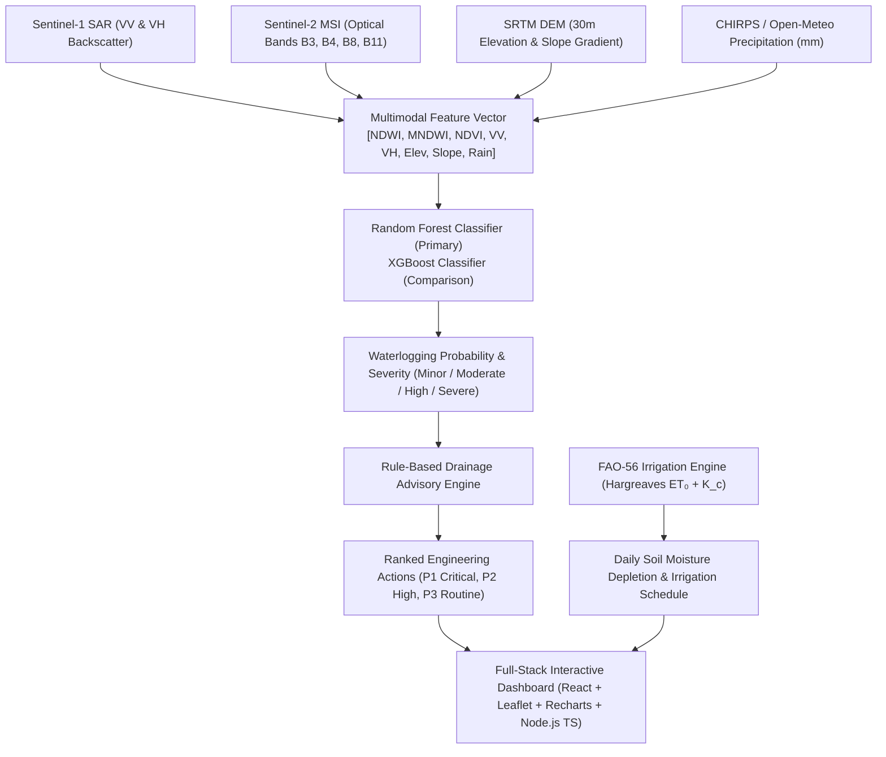

# JalaDrishti AI — Earth Observation Flood Intelligence & Agro-Water Platform

An enterprise-grade multimodal Earth Observation & AI decision-support platform designed for municipal flood resilience, terrain drainage remediation, and precision FAO-56 crop irrigation water balance management across all 31 Karnataka districts.

---

## 🌟 Platform Capabilities
- **Multimodal Flood Mapping**: Sentinel-1 SAR + Sentinel-2 Optical + SRTM DEM + Live Rainfall + Doppler Radar.
- **Stable Anchored Severity Markers**: Pin-point geographic anchoring (zero jitter/drift on zoom/pan) with distinct geometric severity indicators:
  - 🔴 **Severe**: Red circular beacon (critical road/sump inundation)
  - 🟠 **High**: Orange diamond (major conduit choke)
  - 🟡 **Moderate**: Yellow pin (surface water pooling)
  - 🟢 **Minor**: Green triangle (absorptive ground / manageable runoff)
- **District-Wide Waterlogging Hotspot Network**: Distinct, realistic incident counts across all 31 Karnataka districts (10 to 40 hotspots each), 100% interconnected with official drainage assets (`DRN-...`).
- **Permanent Live Background Execution**: Integrated supervisor that runs detached in the background on Windows, surviving terminal closures, reboots, and providing automatic crash recovery.
- **Karnataka Agro-Climatic Observatory**: High-resolution 10-day forecasts across all 31 Karnataka districts.
- **FAO-56 Dual Crop Coefficient Engine**: Precision irrigation scheduling for 100+ Karnataka crops & 12 soil series.
- **Hydrological Drainage Decision Matrix**: Automated P1/P2/P3 municipal & field engineering advisories.

---

## 🛰️ System Architecture



---

## 🔬 Core Methodology & Mathematical Formulations

### 1. Per-Pixel Feature Extraction
$$\mathbf{X} = [\text{NDWI}, \text{MNDWI}, \text{NDVI}, \text{VV}, \text{VH}, \text{Elevation}, \text{Slope}, \text{Rainfall}]$$
- **NDWI (Normalized Difference Water Index)**: $\frac{\text{Green} - \text{NIR}}{\text{Green} + \text{NIR}} = \frac{B_3 - B_8}{B_3 + B_8}$
- **MNDWI (Modified NDWI)**: $\frac{\text{Green} - \text{SWIR}}{\text{Green} + \text{SWIR}} = \frac{B_3 - B_{11}}{B_3 + B_{11}}$
- **NDVI (Normalized Difference Vegetation Index)**: $\frac{\text{NIR} - \text{Red}}{\text{NIR} + \text{Red}} = \frac{B_8 - B_4}{B_8 + B_4}$
- **Sentinel-1 SAR VV & VH (dB)**: Microwave C-band backscatter ($<-16\text{ dB}$ indicates specular reflection off open water surface).
- **SRTM DEM**: Topographical depression elevation ($m$) and slope ($^\circ$).

### 2. Machine Learning Severity Categorization
- **Minor Severity**: $p < 0.35$ (Normal soil moisture / absorptive terrain)
- **Moderate Severity**: $0.35 \le p < 0.60$ (Surface water pooling, agricultural soil saturation)
- **High Severity**: $0.60 \le p < 0.80$ (Significant waterlogging, arterial road runoff choke)
- **Severe Inundation**: $p \ge 0.80$ (Deep stagnant floodwater, culvert failure, structural hazard)

### 3. Rule-Based Drainage Decision Logic
- **Depression Stagnation**: Severity = Severe $\land$ Slope $< 2.0^\circ \implies$ Deploy high-capacity mobile dewatering axial pumps ($\ge 500\text{ m}^3/\text{hr}$) & dredge outfall channels.
- **Urban Conduit Choke**: Severity = High/Severe $\land$ Land Use = Urban Built-up $\implies$ Mechanical clearance of box culverts, storm grates, and roadside swales.
- **Persistent Surcharge**: Post-monsoon waterlogging recurrent $\implies$ Construct decentralized rainwater detention sump with recharge wells.

### 4. FAO-56 Crop Water Requirement & Irrigation Engine
- **Reference Evapotranspiration ($ET_0$)** via Hargreaves-Samani equation:
  $$ET_0 = 0.0023 \cdot R_a \cdot (T_{\text{mean}} + 17.8) \cdot \sqrt{T_{\text{max}} - T_{\text{min}}}$$
- **Crop Evapotranspiration ($ET_c$)**: $ET_c = ET_0 \times K_c$
- **Total Available Water ($TAW$)**: $TAW = (\theta_{FC} - \theta_{WP}) \times Z_r$
- **Readily Available Water ($RAW$)**: $RAW = p_{\text{depletion}} \times TAW$
- **Trigger**: If Root Depletion $\ge RAW \implies$ *"IRRIGATE TODAY"*.

---

## ⚡ Quick Start & Permanent Live Running

### Prerequisites
1. **Node.js 20+** & npm
2. **Python 3.10+** (with `uvicorn`, `fastapi`, `joblib`, `scikit-learn`, `numpy`)
3. **Database**: Built-in zero-config SQLite (`backend/data/waterlogging.sqlite`) with optional PostgreSQL fallback.

### 🚀 Permanent Live Background Mode (Recommended)
To run the entire system permanently in the background (survives terminal closure):

```powershell
# 1-Click Launch via Batch
.\start_live.bat

# Or via npm
npm run live
```
The application will launch detached in the background, bind all ports, and automatically open `http://localhost:3001` in your default browser.

### 📊 Service Health & Status Check
```powershell
# Check live status across all 3 ports (5000, 3001, 8000)
.\status_live.bat
# Or
npm run status
```

### 🛑 Stop Services
```powershell
# Cleanly shutdown supervisor and free all ports
.\stop_live.bat
# Or
npm run stop
```

### 🖥️ Foreground Development Mode
```powershell
npm run dev
```

### Service Endpoints
| Component | Port | URL | Description |
|---|---|---|---|
| **Frontend Web App** | `3001` | [http://localhost:3001](http://localhost:3001) | Interactive React + Leaflet Map & Analytics |
| **Backend Express API** | `5000` | [http://localhost:5000/api](http://localhost:5000/api) | Node.js Express Gateway & SQLite persistence |
| **Backend Health** | `5000` | [http://localhost:5000/health](http://localhost:5000/health) | Gateway health check endpoint |
| **FastAPI ML Service** | `8000` | [http://localhost:8000/docs](http://localhost:8000/docs) | ML inference, FAO-56 crop engine docs |

---

## 📁 Repository Structure
```
waterlogging_project/
├── backend/                  # Node.js TypeScript Express Gateway
│   ├── src/
│   │   ├── controllers/      # Incident & telemetry endpoints
│   │   ├── db/               # Real district hotspots & SQLite / PG driver
│   │   ├── routes/           # API router (/api/incidents, /api/weather, etc.)
│   │   └── server.ts         # Server lifecycle & crash-resilience handler
│   └── data/                 # Persistent SQLite database storage
├── frontend/                 # React 18 + Vite Web Application
│   ├── src/
│   │   ├── components/       # FloodMapPage, Header, Weather, Drainage, etc.
│   │   ├── services/         # Axios API clients
│   │   └── App.tsx           # Primary dashboard layout
│   └── vite.config.ts        # Vite proxy configuration (port 3001)
├── ml_service/               # Python FastAPI Microservice
│   ├── main.py               # ML API endpoints & FAO-56 engine
│   ├── drainage_engine.py    # Rule-based municipal advisory logic
│   └── artifacts/            # Trained RF & XGBoost models
├── scripts/                  # Process supervisor & service management
│   ├── runner.mjs            # Node live runner with auto-restart daemon
│   ├── start_live.vbs        # Detached Windows background launcher
│   ├── status.mjs            # Live health check prober
│   └── stop.mjs              # Clean shutdown & port freeing script
├── start_live.bat            # 1-Click Windows Permanent Live Starter
├── status_live.bat           # 1-Click Windows Status Checker
├── stop_live.bat             # 1-Click Windows Service Stopper
├── ecosystem.config.cjs      # PM2 ecosystem configuration
└── package.json              # Project scripts & dependencies
```
