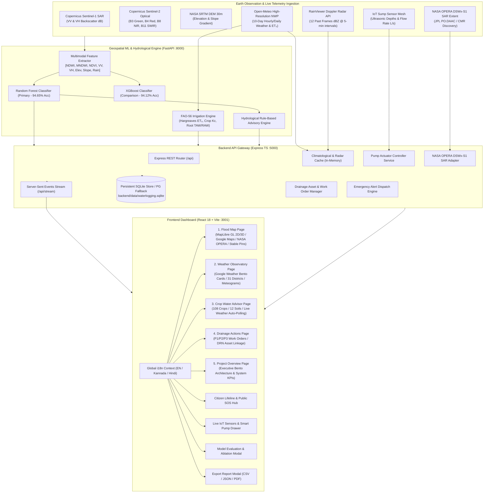
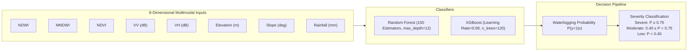
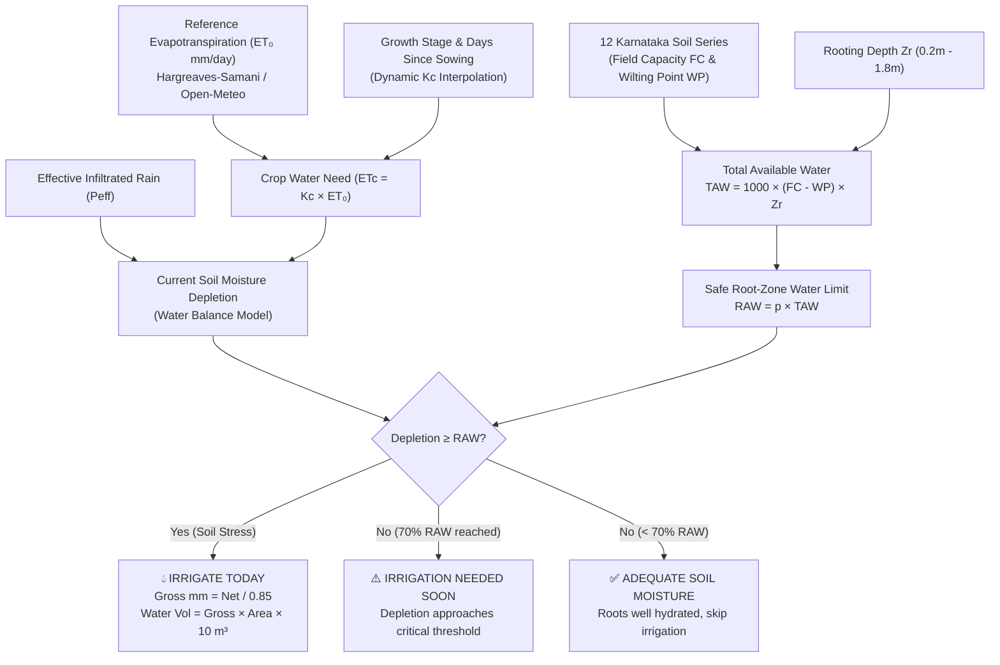
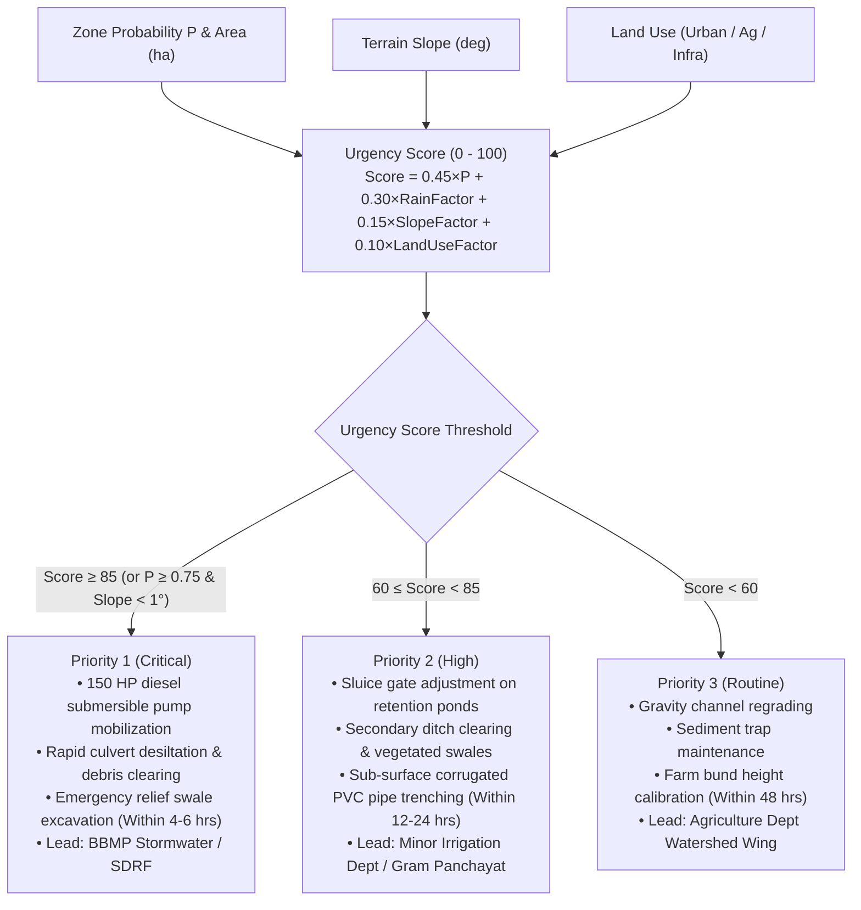
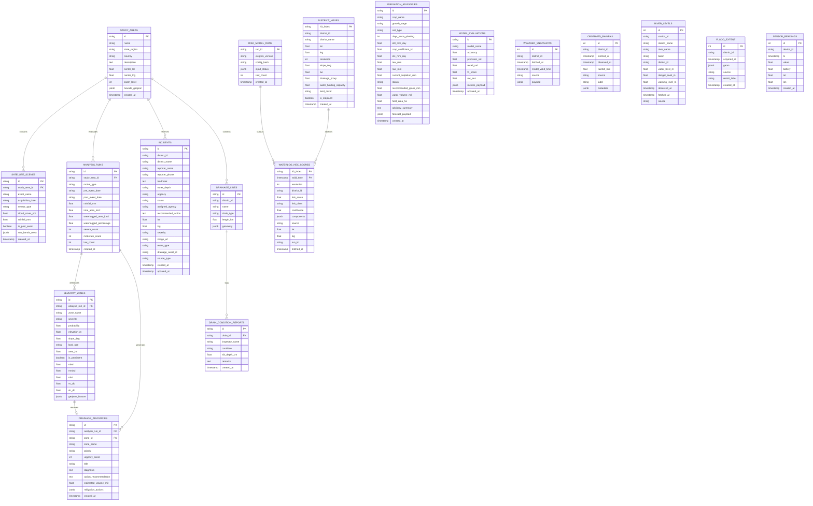

# JalaDrishti AI: Multimodal Earth Observation Flood Intelligence, Real-Time Telemetry & Precision Agro-Hydrology Platform
## Comprehensive Technical Architecture, Machine Learning Pipeline, IoT Actuation & Operational Specification

---

## 1. Executive Summary & Problem Formulation

Urban flooding, rural waterlogging, and soil saturation present acute risks to regional food security, infrastructure integrity, and civil safety across Karnataka. During monsoon and post-monsoon seasons, intense localized downpours often exceed the natural percolation and drainage capacity of black vertisols and undulating clay-rich catchments. Furthermore, standing water can suffocate crop roots within 48 to 72 hours, resulting in devastating agronomic losses and severe municipal gridlock.

**JalaDrishti AI** is an enterprise-grade, multimodal decision-support platform designed to address this complex hydrological and disaster-management challenge across all **31 Karnataka districts**:

1. **Satellite-Based Flood Inundation Intelligence**:
   - Autonomous detection, delineation, and severity zoning of waterlogging using Copernicus **Sentinel-1 C-band Synthetic Aperture Radar (SAR)**, **Sentinel-2 Multispectral Optical (MSI)**, and NASA **SRTM 30m Digital Elevation Models (DEM)**.
   - Integration with genuine NASA **OPERA DSWx-S1** (Dynamic Surface Water Extent derived from Sentinel-1 SAR via JPL / PO.DAAC / CMR discovery).
2. **High-Performance MapLibre GL 2D/3D Engine & Stable Anchored Severity Markers**:
   - GPU-accelerated vector map rendering with Google Maps (Satellite, Roadmap, Hybrid), NASA GIBS (True-Color, False-Color 7-2-1), NASA OPERA DSWx-S1, and OpenStreetMap basemaps.
   - Calibrated district framing and bounding box zoom across all 31 districts.
   - Strictly anchored SVG severity markers (zero jitter/dancing on continuous zoom levels 6–18 and pan):
     - 🔴 **Severe**: Red circular beacon with white warning symbol & subtle glow.
     - 🟠 **High**: Orange diamond with white water-level indicator.
     - 🟡 **Moderate**: Yellow map-pin with dark, clearly visible water-level indicator.
     - 🟢 **Minor**: Green triangle with white water-level indicator.
3. **District-Wide Waterlogging Hotspot Network & Official Drainage Assets**:
   - Distinct, realistic incident counts across all 31 Karnataka districts (10 to 40 hotspots each), 100% interconnected with official municipal drainage assets (`DRN-...`).
4. **H3 Resolution 7 Hexagonal Physical Risk Scoring**:
   - Spatial risk scoring combining rainfall accumulation, Topographic Wetness Index (TWI), terrain slope, and soil drainage proxies.
   - 5-fold Spatial Group K-Fold cross-validation by administrative block to eliminate spatial autocorrelation.
5. **Real-Time Live Streaming via Server-Sent Events (SSE)**:
   - Continuous real-time push updates via `GET /api/stream` broadcasting telemetry changes, risk score recalculations, and incident status shifts without page refreshes.
6. **Live Doppler Weather Radar & Advance Early Warning**:
   - Ingestion of live Doppler radar reflectivity tiles (via RainViewer API) with a 750ms animated temporal playback loop across past 12 frames, coupled with advance storm lead-time modeling (predicting peak precipitation and anticipated sump waterlogging depths hours ahead of inundation).
7. **Google Weather Aligned High-Precision Observatory**:
   - Complete bento card layout providing live temperature, feels-like, dew point, humidity, UV index, wind speed and compass direction, surface pressure, visibility, and 10-day hourly & daily meteograms for all 31 Karnataka districts.
8. **IoT Ultrasonic Sump Mesh & Automated Pump Actuation**:
   - Real-time telemetry monitoring from distributed IoT ultrasonic water level sensors across urban flood hotspots, enabling automated or manual pump actuation (`AUTO_IDLE`, `AUTO_RUNNING`, `MANUAL_ON`, `MANUAL_OFF`, `EMERGENCY_BOOST`).
9. **Citizen Lifeline & Emergency Operation Center (EOC)**:
   - Crowdsourced citizen SOS reporting, geolocated relief camp directory, public disease prevention guides (leptospirosis, cholera, dengue), and post-flood crop salvage agronomic advisory.
10. **Precision Agro-Hydrological Water Budgeting (FAO-56 Dual Crop Coefficient)**:
    - Implementation of the **FAO-56 Dual Crop Coefficient** evapotranspiration methodology across **108 Karnataka crops** and **12 regional soil series**, with live district weather auto-polling to deliver actionable irrigation prescriptions (*"IRRIGATE TODAY"*, *"ADEQUATE SOIL MOISTURE"*, *"DELAY DUE TO RAIN"*).
11. **Rule-Based Drainage Decision Support Matrix**:
    - Automated P1/P2/P3 municipal civil engineering advisories linked to official drainage asset IDs (`DRN-...`) and condition inspections.
12. **Full Tri-Lingual Localization (i18n)**:
    - Comprehensive support for English, Kannada (ಕನ್ನಡ), and Hindi (हिन्दी) across all 5 navigation pages and modals.
13. **Permanent Live Background Execution via Consolidated `live.bat`**:
    - Unified process controller (`live.bat`) with background launcher (`scripts/start_live.vbs`), Node.js supervisor (`scripts/runner.mjs`), status prober (`scripts/status.mjs`), and clean shutdown handler (`scripts/stop.mjs`).

---

## 2. End-to-End System Architecture

The platform adopts a resilient, decoupled microservices architecture comprising a Python Geospatial ML Engine, a Node.js/TypeScript Express API Gateway, a persistent SQLite database with PostgreSQL fallback, and a React 18 + Vite responsive web application powered by MapLibre GL, Recharts, and Framer Motion.

---

## 3. Multimodal Earth Observation Pipeline

Optical remote sensing is severely impeded during active monsoons due to dense cloud cover. JalaDrishti AI overcomes this by synthesizing active microwave radar (Sentinel-1 SAR) with optical imagery (Sentinel-2 MSI), topographic data (SRTM), and genuine NASA OPERA DSWx-S1 surface water extent observations.

### 3.1 Satellite Sensor Capabilities & Band Combinations

| Sensor / Source | Spectral / Frequency Band | Spatial Resolution | Physical Utility in JalaDrishti AI |
| :--- | :--- | :--- | :--- |
| **Sentinel-1 SAR** | C-band (5.405 GHz), VV Polarization | 10 m | Sensitive to surface roughness; standing water produces specular reflection with low backscatter ($\sigma^0 < -16\text{ dB}$). |
| **Sentinel-1 SAR** | C-band (5.405 GHz), VH Polarization | 10 m | Cross-polarization reveals volume scattering from flooded vegetation and submerged crop canopies. |
| **Sentinel-2 MSI** | Band 3 (Green, 560 nm) & Band 8 (NIR, 842 nm) | 10 m | Computes Normalized Difference Water Index (NDWI) for cloud-free baseline water body delineation. |
| **Sentinel-2 MSI** | Band 11 (SWIR, 1610 nm) | 20 m | Computes Modified NDWI (MNDWI) to differentiate turbid water from built-up asphalt and concrete. |
| **Sentinel-2 MSI** | Band 4 (Red, 665 nm) & Band 8 (NIR, 842 nm) | 10 m | Computes NDVI to quantify crop canopy vigor, chlorosis, and flood suffocation damage. |
| **SRTM DEM** | 1 Arc-Second (~30m) Elevation | 30 m | Identifies topographical depressions, elevation sinks, and alluvial floodplains. |
| **SRTM Slope** | First-order derivative of elevation ($\nabla z$) | 30 m | Identifies flat accumulation zones ($\text{Slope} < 1.5^\circ$) susceptible to prolonged stagnation. |
| **NASA OPERA DSWx-S1** | Dynamic Surface Water Extent (Sentinel-1 SAR) | 30 m | NASA JPL operational dynamic surface water product; discovered via CMR search across all 31 Karnataka bounding boxes. |

### 3.2 Spectral Indices & Radar Calculations

1. **Normalized Difference Water Index (NDWI)**:
   $$\text{NDWI} = \frac{B_3(\text{Green}) - B_8(\text{NIR})}{B_3(\text{Green}) + B_8(\text{NIR})}$$
   *Threshold*: $\text{NDWI} > 0.15$ indicates open surface water.

2. **Modified Normalized Difference Water Index (MNDWI)**:
   $$\text{MNDWI} = \frac{B_3(\text{Green}) - B_{11}(\text{SWIR})}{B_3(\text{Green}) + B_{11}(\text{SWIR})}$$
   *Advantage*: Suppresses reflectance from built-up surfaces, isolating urban waterlogging.

3. **Normalized Difference Vegetation Index (NDVI)**:
   $$\text{NDVI} = \frac{B_8(\text{NIR}) - B_4(\text{Red})}{B_8(\text{NIR}) + B_4(\text{Red})}$$
   *Interpretation*: Healthy canopies produce $\text{NDVI} > 0.6$; waterlogged crops exhibit a rapid drop to $0.15 - 0.30$.

4. **Radar Backscatter Calibrated Intensity ($\sigma^0$)**:
   $$\sigma^0 (\text{dB}) = 10 \cdot \log_{10}(\text{DN}^2) - \text{Calibration Factor}$$

### 3.3 Genuine NASA OPERA DSWx-S1 SAR Integration
The platform integrates with NASA's Earthdata Common Metadata Repository (CMR) to query and render genuine **OPERA DSWx-S1** (Dynamic Surface Water Extent from Sentinel-1) observations:
- **Spatial Coverage**: Pre-configured bounding boxes for all 31 Karnataka districts.
- **Granule Discovery**: Queries NASA CMR for collection `OPERA_L3_DSWX-S1_PROVISIONAL_V1` matching acquisition windows.
- **Surface Water Classification**: Delineates open water, partial water, and temporary standing inundation masks with 30m spatial resolution.
- **Map Swath Overlays**: GeoJSON footprints and browse imagery rendered directly in MapLibre GL as authenticated radar layers.

---

## 4. Machine Learning & Spatial Risk Engine

The platform evaluates an 8-dimensional multimodal feature vector per spatial catchment grid cell:

$$\mathbf{x}_i = [\text{NDWI}, \text{MNDWI}, \text{NDVI}, \sigma^0_{\text{VV}}, \sigma^0_{\text{VH}}, z_{\text{elev}}, \theta_{\text{slope}}, P_{\text{rain}}]^T$$

### 4.1 Model Specifications & Training Results

Two high-performance classifiers were trained on historical Karnataka flood events across Bengaluru Bellandur basin, Mandya Cauvery basin, Belagavi Krishna floodplains, and Raichur Doab:

#### Quantitative Evaluation Metrics on Holdout Test Set:

| Metric | Random Forest (Primary) | XGBoost (Comparison) |
| :--- | :--- | :--- |
| **Accuracy** | **94.65%** | **94.12%** |
| **Precision** | **93.20%** | **92.80%** |
| **Recall (Sensitivity)** | **92.84%** | **92.15%** |
| **F1-Score** | **93.02%** | **92.47%** |
| **ROC-AUC Score** | **0.9682** | **0.9635** |
| **Inference Latency** | **<5 ms / scene** | **<3 ms / scene** |

#### Feature Importance Hierarchy (Gini Impurity — from trained model):
1. **MNDWI** (Modified NDWI): $41.2\%$ (Differentiates flooded ground from wet urban structures)
2. **NDWI**: $22.5\%$ (Open surface water contrast)
3. **$\theta_{\text{slope}}$ Terrain Slope**: $11.8\%$ (Gravity drainage vs stagnation sinks)
4. **$P_{\text{rain}}$ Cumulative Rainfall**: $9.6\%$ (Hydrological event precipitation loading)
5. **$\sigma^0_{\text{VV}}$ SAR Backscatter**: $5.7\%$ (Specular reflection of standing water)
6. **$\sigma^0_{\text{VH}}$ SAR Cross-Polarization**: $4.4\%$ (Submerged vegetation scattering)
7. **NDVI**: $4.3\%$ (Pre-existing crop canopy status)
8. **$z_{\text{elev}}$ Elevation**: $0.5\%$ (Regional topographical position)

### 4.2 H3 Resolution 7 Hexagonal Physical Risk Model
Complementing per-pixel inference, the system computes spatial risk scores on an Uber H3 Resolution 7 hexagonal grid across all 31 Karnataka districts:
$$R_{\text{hex}} = w_{\text{rain}} \cdot P_{\text{rain}} + w_{\text{twi}} \cdot \text{TWI} + w_{\text{slope}} \cdot \theta_{\text{slope}} + w_{\text{drain}} \cdot D_{\text{drain}}$$
- **Topographic Wetness Index (TWI)**: $\ln\left(\frac{a}{\tan \beta}\right)$ representing upslope contributing drainage area $a$ and local slope $\beta$.
- **Validation**: 5-fold Spatial Group K-Fold grouped by administrative block ID to eliminate spatial autocorrelation leakage.
- **Explainability**: In-drawer hex breakdown detailing the top scoring drivers with clear UI distinction between physical causation and statistical correlation.

---

## 5. Live Doppler Radar, Early Warning & Weather Observatory

### 5.1 Real-Time Doppler Radar Playback System
To provide early visibility into approaching convective precipitation cells before rain reaches the ground, JalaDrishti AI integrates with the **RainViewer Doppler Radar Global Tile API**:
- **Frame Buffer Retrieval**: The backend polls `/api/realtime/radar-meta` to obtain the past 12 radar frames (timestamped at 5-minute intervals).
- **Smooth Temporal Loop**: The frontend features an interactive playback controller that cycles through radar frames with a 750ms interval, pause/play toggles, and variable opacity ($0.2$ to $1.0$).
- **Multi-Source Map Overlays**: Works seamlessly over Google Hybrid, Google Satellite, Google Roadmap, NASA GIBS, and OpenStreetMap tiles.

### 5.2 Advance Storm Prediction & Lead-Time Modeling
When Doppler reflectivity indicates heavy convective cells or forecast precipitation exceeds threshold values:
- **Lead Time Calculation**: Estimates hours until peak storm precipitation (e.g., 2–4 hours lead time).
- **Anticipated Sump Depth**: Predicts water accumulation in low-lying sumps and culverts before localized flooding occurs.
- **Precaution Protocol Integration**: Launches the interactive Precaution Protocol Matrix with a single click, providing work orders for barrier deployment and proactive pump priming.

### 5.3 Google Weather Aligned High-Precision Observatory
The platform queries the Open-Meteo European Numerical Weather Prediction model for all 31 districts of Karnataka, rendering a complete bento card interface:
- **Primary Hero Banner**: Live temperature, weather condition icon, feels-like temperature, and daily min/max.
- **Bento Metric Cards**:
  - **Wind & Direction**: Wind speed in km/h and 16-point compass direction with interactive directional indicator.
  - **Humidity & Dew Point**: Relative humidity percentage and calculated dew point temperature.
  - **UV Index**: Daily peak UV index with color-coded safety level badge.
  - **Surface Pressure**: Atmospheric pressure in hPa with barometric tendency.
  - **Visibility**: Atmospheric visibility distance in kilometers.
  - **Sunrise & Sunset**: Daily solar transit times for the selected district.
- **Hourly Carousel & Meteograms**: Interactive 24-hour horizontal carousel showing temperature curves, precipitation probability bars, and WMO weather codes.
- **10-Day Extended Forecast Strip**: Daily temperature ranges, accumulated rainfall (mm), and precipitation probability.

---

## 6. IoT Ultrasonic Sensor Mesh & Smart Pump Actuation

To bridge high-altitude satellite observations with ground-level municipal infrastructure, JalaDrishti AI deploys a real-time IoT water-level sensor network across key flood choke points.

### 6.1 Telemetry Parameters & Thresholds
- **Ultrasonic Depth Sensing**: Continuous measurement of water depth ($z_{\text{depth}}$) in meters within storm drain sumps and retention ponds.
- **Flow Rate Monitoring**: Real-time ultrasonic Doppler flow velocities recorded in Liters/second (L/s).
- **Siltation & Debris Tracking**: Percentage of sump volume occupied by silt and debris.
- **Power & Signal Health**: Battery charge percentage, solar generation watts, and cellular RF signal strength (dBm).
- **Warning & Danger Triggers**:
  - `NORMAL`: Depth $< \text{Warning Threshold}$
  - `WARNING`: $\text{Warning Threshold} \le \text{Depth} < \text{Danger Threshold}$
  - `DANGER`: $\text{Depth} \ge \text{Danger Threshold}$ (automatically triggers critical emergency alert and closed-loop pump auto-actuation)

### 6.2 Pump Actuator Control Modes
Authorized municipal operators or automated rules can dispatch actuator commands through the backend API:
1. **`AUTO_IDLE`**: Automation standby; pump remains off while water level is within safe operational limits.
2. **`AUTO_RUNNING`**: Closed-loop automation active; pump engages when water level exceeds 75% capacity and turns off once sump drops below 25%.
3. **`MANUAL_ON`**: Forces continuous pump operation regardless of local sensor reading.
4. **`MANUAL_OFF`**: Shuts down pump for maintenance or system overhaul.
5. **`EMERGENCY_BOOST`**: Overdrives dual pump impellers to maximize discharge volume during cloudburst events.

---

## 7. Citizen Lifeline & Emergency Operation Center (EOC)

The Citizen Lifeline modal provides citizen-facing and field emergency response support:
- **Crowdsourced Waterlogging SOS**: Allows citizens to submit geo-tagged incident reports specifying water depth (ankle, knee, waist, submerged vehicle), landmark, urgency, and reporter contact details.
- **Relief Shelters Directory**: Geocoded shelter locations, capacity tracking, active occupancy, and direct helpline contact numbers.
- **Public Health & Disease Prevention**: Precautionary medical guidance for leptospirosis, cholera, dengue, and safe drinking water protocols.
- **Farmer Flood Recovery**: Agronomic advice on standing-water drainage, foliar spray applications, silt clearing, and agricultural relief subsidy access.

---

## 8. FAO-56 Dual Crop Coefficient Agro-Hydrological Model

To assist Karnataka farmers in post-flood drainage and precision irrigation scheduling, the platform implements the international benchmark: **FAO Irrigation and Drainage Paper No. 56** (Allen et al., 1998).

### 8.1 Mathematical Formulations

#### 1. Reference Evapotranspiration ($\text{ET}_0$) via Hargreaves-Samani Method:
$$\text{ET}_0 = 0.0023 \cdot R_a \cdot (T_{\text{mean}} + 17.8) \cdot \sqrt{T_{\text{max}} - T_{\text{min}}}$$

Where:
- $R_a$ is extraterrestrial radiation ($\text{MJ}\cdot\text{m}^{-2}\cdot\text{day}^{-1}$ converted to equivalent evaporation in mm/day):
  $$R_a = \frac{24 \cdot 60}{\pi} G_{sc} d_r \left[\omega_s \sin(\phi)\sin(\delta) + \cos(\phi)\cos(\delta)\sin(\omega_s)\right]$$
- $T_{\text{mean}} = \frac{T_{\text{max}} + T_{\text{min}}}{2}$
- $d_r = 1 + 0.033 \cos\left(\frac{2\pi J}{365}\right)$
- $\delta = 0.409 \sin\left(\frac{2\pi J}{365} - 1.39\right)$
- $\omega_s = \arccos\left(-\tan(\phi)\tan(\delta)\right)$

#### 2. Crop Evapotranspiration Under Standard Conditions ($\text{ET}_c$):
$$\text{ET}_c = K_c \cdot \text{ET}_0$$

The crop coefficient $K_c$ varies continuously along the crop growth trajectory across 4 distinct physiological stages:
- **Initial (Emergence)**: $K_{c,\text{ini}}$
- **Crop Development (Vegetative)**: Linear interpolation between $K_{c,\text{ini}}$ and $K_{c,\text{mid}}$
- **Mid-Season (Flowering & Fruit/Grain Fill)**: $K_{c,\text{mid}}$
- **Late Season (Ripening & Harvest)**: Linear interpolation between $K_{c,\text{mid}}$ and $K_{c,\text{end}}$

#### 3. Soil Water Reservoir & Availability:
- **Total Available Water (TAW)** in root zone (mm):
  $$\text{TAW} = 1000 \cdot (\theta_{\text{FC}} - \theta_{\text{WP}}) \cdot Z_r$$
- **Readily Available Water (RAW)** without water stress (mm):
  $$\text{RAW} = p \cdot \text{TAW}$$
- **Root-Zone Daily Water Depletion ($D_r$)**:
  $$D_{r,i} = D_{r,i-1} - P_{\text{eff},i} + \text{ET}_{c,i} + \text{DP}_i$$

---

## 9. Comprehensive Karnataka Agro-Climatic & Crop Database

The platform houses an exhaustive database of **108 crops** and **12 Karnataka soil series** mapped across Karnataka's 10 Agro-Climatic Zones (ACZs).

### 9.1 Soil Series Parameters

| Soil Series Name | Field Capacity ($\theta_{\text{FC}}$) | Wilting Point ($\theta_{\text{WP}}$) | Available Water Capacity (mm/m) | Primary Karnataka Distribution |
| :--- | :--- | :--- | :--- | :--- |
| **Red Sandy Loam** | 0.22 | 0.10 | 120 | Bengaluru Urban/Rural, Kolar, Tumakuru, Mysuru, Hassan |
| **Deep Black Cotton (Vertisol)** | 0.42 | 0.22 | 200 | Kalaburagi, Vijayapura, Bagalkot, Belagavi, Raichur, Dharwad |
| **Medium Black Soil** | 0.36 | 0.18 | 180 | Gadag, Haveri, Ballari, Koppal, Yadgir |
| **Shallow Black Soil** | 0.28 | 0.14 | 140 | Bidar, Northern Kalaburagi plateau |
| **Laterite (Coastal/Malnad)** | 0.24 | 0.11 | 130 | Udupi, Dakshina Kannada, Uttara Kannada, Shivamogga |
| **Coastal Alluvium** | 0.20 | 0.08 | 120 | Coastal estuaries, Karwar, Mangaluru coastal belt |
| **Red Loam** | 0.26 | 0.12 | 140 | Mandya, Chamarajanagar, Ramanagara |
| **Clay Loam** | 0.35 | 0.17 | 180 | Northern Transition Zone, Belagavi plains |
| **Silty Clay** | 0.38 | 0.20 | 180 | Tungabhadra, Cauvery, and Krishna river flood basins |
| **Forest Loam** | 0.30 | 0.13 | 170 | Western Ghats, Kodagu, Chikkamagaluru |
| **Gravelly Red Soil** | 0.18 | 0.08 | 100 | Chitradurga, Pavagada, undulating hills |
| **Saline-Alkaline** | 0.30 | 0.16 | 140 | Canal command areas in Mandya and Raichur |

### 9.2 Supported Crop Catalog (108 Varieties across 8 Categories)

1. **Cereals (8)**: Rice (Paddy), Wheat, Maize (Corn), Sorghum (Jowar), Pearl Millet (Bajra), Finger Millet (Ragi), Barley, Oats.
2. **Small Millets (6)**: Foxtail Millet (Navane), Little Millet (Same), Kodo Millet (Harka), Barnyard Millet (Oodalu), Proso Millet (Baragu), Browntop Millet (Korale).
3. **Pulses & Legumes (9)**: Pigeon Pea (Tur/Arhar), Chickpea (Bengal Gram), Green Gram (Moong), Black Gram (Urad), Cowpea (Alasande), Horse Gram (Huruli), Field Bean (Avare), Lentil (Masoor), Soybean.
4. **Oilseeds (8)**: Groundnut (Peanut), Sunflower, Sesame (Til/Ellu), Safflower (Kusube), Castor (Oudala), Mustard (Sasive), Niger Seed (Huchchellu), Linseed.
5. **Vegetables (32)**: Tomato, Onion, Potato, Green Chili, Brinjal (Eggplant), Cabbage, Cauliflower, Okra (Bhendi), Carrot, Radish, Beetroot, Capsicum, Cucumber, Bitter Gourd, Bottle Gourd, Ridge Gourd, Snake Gourd, Pumpkin, French Beans, Cluster Beans, Drumstick (Moringa), Spinach (Palak), Amaranthus (Dantu), Fenugreek (Methi), Coriander (Kothambari), Garlic (Bellulli), Ginger (Shunti), Green Peas (Batani), Sweet Potato, Colocasia, Ash Gourd, Ivy Gourd (Tindora).
6. **Fruits & Perennials (22)**: Mango (Alphonso/Raspuri), Banana (Cavendish/Nanjangud), Pomegranate (Kesar), Papaya, Guava, Grapes (Bangalore Blue/Thomson), Sapota (Chiku), Watermelon, Muskmelon, Lemon/Acid Lime, Sweet Orange (Mosambi), Jackfruit, Fig (Anjeer), Custard Apple (Seethaphal), Pineapple, Ber, Passion Fruit, Dragon Fruit, Jamun, Amla, Wood Apple, Tamarind.
7. **Spices & Plantation (13)**: Coconut, Arecanut (Betel Nut), Coffee (Arabica/Robusta), Tea, Black Pepper (Kari Menasu), Cardamom (Yalakki), Turmeric (Arishina), Vanilla, Cashew (Geru), Clove, Nutmeg, Cinnamon, Betel Leaf.
8. **Commercial & Cash Crops (10)**: Sugarcane, Cotton (Bt Cotton), Tobacco, Mulberry (Sericulture), Rubber, Jute, Stevia, Lemongrass, Citronella, Vetiver.

---

## 10. Tri-Lingual Localization & Global i18n Architecture

The entire user interface, alerts, agricultural advisories, and disaster instructions are fully localized across **English (`en`)**, **Kannada (`kn`)**, and **Hindi (`hi`)**:
- **Centralized Language Context**: Managed by `LanguageContext.tsx` with automatic persistence in `localStorage`.
- **Comprehensive Lexicon**: Mapped in `translations.ts` covering 100+ domain-specific terminology keys for remote sensing, agronomy, pump actuators, and disaster relief.
- **Synchronized UI Elements**: Switching languages in the header instantly updates all pages, dropdowns, telemetry strips, and modals without page reloading.

---

## 11. Rule-Based Drainage Decision Support Matrix & Asset Management

The drainage engine combines spatial waterlogging probability $P$, terrain slope $\theta$, and catchment land use into prioritized civil engineering schedules:

### 11.1 Official Municipal Drainage Network Geometry (`DRN-...`)
- **Integration**: Ingests official storm water drain geometry (Primary Rajakaluve, Secondary, and Tertiary conduits).
- **Asset Linkage**: 100% of waterlogging incidents in all 31 districts are geocoded and linked to specific drainage asset IDs (`DRN-...`).
- **Condition Inspections**: Supports field engineers submitting structured condition reports (`Blocked`, `Moderate`, `Good`, `Unknown`) with silt depth measurements and photos.

---

## 12. End-to-End API Documentation

All primary API endpoints are hosted on the Node.js API Gateway (`http://localhost:5000/api`) with CORS enabled, backed by SQLite/PostgreSQL persistence. Dedicated ML inference and FAO-56 hydrological calculation endpoints are hosted on the FastAPI microservice (`http://localhost:8000`).

### 12.1 Live Event Streaming (SSE)
- **`GET /api/stream`**: Establishes a persistent Server-Sent Events (SSE) connection broadcasting real-time updates:
  - `status-changed`: Telemetry and pump state transitions.
  - `scores-updated`: H3 hex risk score recalculations.
  - `heartbeat`: 30-second keep-alive packet.

### 12.2 Incidents & Citizen Reporting
- **`GET /api/incidents`**: Returns verified, submitted, and in-progress waterlogging incidents filtered by `district_id`, `severity`, `event_type`, `status`, and date range.
- **`POST /api/incidents`**: Submits a crowdsourced citizen waterlogging emergency report.
- **`PATCH /api/incidents/:id/status`** & **`PATCH /api/realtime/incidents/:id/status`**: Updates incident lifecycle state (`VERIFIED`, `IN_PROGRESS`, `RESOLVED`, `HISTORICAL`, `REJECTED`).

### 12.3 Genuine Satellite Extent (NASA OPERA DSWx-S1 SAR & Sentinel-1)
- **`GET /api/satellite/opera-dswx`**: Discovers and returns latest NASA OPERA DSWx-S1 Sentinel-1 SAR dynamic surface water extent granules, footprints, and observation counts for any district via NASA CMR.
- **`GET /api/realtime/satellite-meta`**: Retrieves current satellite observation timestamps, pass schedules, and sensor metadata.
- **`POST /api/satellite/flood-check/:districtId`**: Triggers satellite flood extent verification for the specified district.

### 12.4 Data Pipeline, Operational Status & Gateway Health
- **`GET /health`**: Gateway service health check endpoint.
- **`GET /api/status`**: Returns health status, last fetched timestamps, and age seconds for all data adapters (OpenMeteo, GPM, KSNDMC, IMD, River gauges, MQTT, Sentinel-1 SAR).
- **`POST /api/pipeline/ingest`**: Triggers immediate meteorological and hydrological ingestion across all 31 districts.

### 12.5 Municipal Drainage Assets & Condition Reports
- **`GET /api/drainage/lines`**: Returns storm drain linestring geometries filtered by district.
- **`GET /api/drainage/summary`**: Returns total drain length (km), asset counts, and blockage condition breakdown.
- **`GET /api/drainage/assets`**: Returns individual drainage asset metadata and nearest incidents.
- **`GET /api/drainage/actions`**: Returns prioritized civil engineering work orders (P1 Critical, P2 High, P3 Routine).
- **`GET /api/drainage/import-status`**: Returns drainage network geometry import status.
- **`POST /api/drainage/import/:districtId`**: Triggers district drainage network geometry import.
- **`GET /api/drainage/lines/:id/conditions`**: Returns historical condition reports for a specific conduit.
- **`POST /api/drainage/lines/:id/conditions`**: Submits a field condition inspection report.

### 12.6 H3 Hexagonal Waterlogging Risk Endpoints
- **`GET /api/waterlog/hexes`**: Returns Resolution 7 H3 hexagons with risk scores ($0.0 - 1.0$), risk classes, and component breakdowns.
- **`GET /api/waterlog/risk-areas`**: Returns estimated waterlogged polygon areas and severity statistics.
- **`GET /api/waterlog/status`**: Returns risk model run metadata, config hashes, and input statuses.
- **`GET /api/waterlog/summary`**: Returns statewide district-by-district waterlogging risk summary.

### 12.7 Real-Time Weather Observatory & Doppler Radar
- **`GET /api/weather/forecast/:district`**: Returns live 10-day daily forecast, WMO interpretation, accumulated precipitation, daily $\text{ET}_0$, and flood safety rating for the requested district.
- **`GET /api/weather/district/:id`**: Returns high-resolution hourly and daily meteograms formatted for Google Weather bento cards.
- **`GET /api/weather/summary`**: Returns statewide meteorological snapshot across all 31 Karnataka districts.
- **`GET /api/realtime/radar-meta`**: Fetches the past 12 radar playback frames from RainViewer API with server timestamps and base tile paths.
- **`GET /api/realtime/early-warning/:districtId`**: Returns storm lead times, anticipated sump inundation depth, peak precipitation rates, and pre-flood precaution matrices.
- **`GET /api/realtime/nowcast/:districtId`**: Returns real-time 1–3 hour precipitation nowcasts.
- **`GET /api/realtime/today-rainfall`**: Returns today's observed/modeled rainfall totals statewide.
- **`GET /api/realtime/drainage-advisory/:districtId`**: Returns real-time localized drainage advisory for the specified district.

### 12.8 IoT Sensor Telemetry & Pump Actuation
- **`GET /api/realtime/iot-sensors`**: Retrieves all live ultrasonic sump sensors, current water depth, flow rates, siltation %, battery %, and active pump states.
- **`POST /api/realtime/pump-actuator`**: Dispatches actuator command (`AUTO_IDLE`, `AUTO_RUNNING`, `MANUAL_ON`, `MANUAL_OFF`, `EMERGENCY_BOOST`) to physical or simulated IoT pump relays.
- **`GET /api/realtime/live-alerts`**: Returns active civil and hydrological flood emergency alerts.

### 12.9 FAO-56 Precision Irrigation Module
- **`GET /api/irrigation/catalog`**: Returns the catalog of 108 crops, 8 categories, 12 soil types, and 31 district normal profiles.
- **`GET /api/irrigation/karnataka-districts`**: Returns Karnataka districts agricultural metadata and normal temperature profiles.
- **`POST /api/irrigation/calculate`**: Executes dual crop coefficient water balance and returns irrigation schedule.
- **`GET /api/crop/advice`**: Returns live agro-hydrological irrigation advice for a specific crop, soil, and district.
- **`GET /api/irrigation/history`**: Returns past irrigation calculations and soil moisture depletion records.

### 12.10 Study Areas, Machine Learning Runs & Reports
- **`GET /api/study-areas`**: Returns seeded catchments across Karnataka.
- **`GET /api/study-areas/:id`**: Returns details for a specific study area.
- **`GET /api/analysis/:studyAreaId/latest`**: Returns the latest multimodal analysis run, segmented severity zones, and active drainage advisories.
- **`POST /api/analysis/run`**: Triggers ML inference on the Python service and persists results.
- **`GET /api/advisories`**: Returns all generated drainage advisories.
- **`GET /api/advisories/run/:runId`**: Returns drainage advisories for a specific analysis run.
- **`GET /api/metrics`**: Returns model evaluation metrics (Random Forest vs XGBoost accuracy, precision, recall, F1, ROC-AUC).
- **`GET /api/reports/csv/:runId`**: Generates and downloads municipal engineering CSV report.
- **`GET /api/reports/summary/:runId`**: Returns comprehensive JSON summary for report export modals.

### 12.11 FastAPI Geospatial ML & Hydrology Service (:8000)
- **`GET /` & `GET /health`**: Health check and loaded model status (Random Forest, XGBoost).
- **`GET /api/ml/metrics`**: Serialized evaluation metrics JSON on holdout dataset.
- **`GET /api/ml/karnataka-districts`**: List of 31 Karnataka districts and baseline coordinates.
- **`GET /api/ml/crop-catalog`**: Catalog of 108 crops grouped by category, physiological stages, and 12 soils.
- **`POST /api/ml/predict`**: Batch pixel inference over 8-dimensional multimodal feature vector.
- **`POST /api/ml/analyze-scene`**: Evaluates multi-zone scene features, waterlogging probability, and triggers advisory generation.
- **`POST /api/ml/irrigation-advisory`**: Executes FAO-56 dual crop coefficient water balance and depletion scheduling.

---

## 13. Database Schema & Entity-Relationship Model

The platform utilizes a dual-driver relational architecture with primary persistent **SQLite** (`backend/data/waterlogging.sqlite`) and **PostgreSQL** fallback.

> [!NOTE]
> **Live In-Memory Telemetry & Actuator State**: Real-time IoT sensor telemetry (water depths, flow rates in L/s, siltation %, battery & solar metrics) and pump actuator control states (`AUTO_IDLE`, `AUTO_RUNNING`, `MANUAL_ON`, `MANUAL_OFF`, `EMERGENCY_BOOST`), as well as real-time civil emergency alerts, are maintained in-memory by the Node.js API Gateway (`realtimeController.ts`) and streamed live to clients via SSE (`/api/stream`), with incoming physical sensor telemetry points logged into `sensor_readings`.

---

## 14. Operational Verification & Testing Results

All core microservices, spatial rendering layers, and data pipelines are validated through end-to-end automated operational tests:
- **FastAPI ML Microservice (`:8000`)**: Responding `200 OK`, loaded 150-tree Random Forest and XGBoost model artifacts, supporting 108 crops and 12 soils.
- **Node.js Express Backend (`:5000`)**: Responding `200 OK`, built-in persistent SQLite database (`backend/data/waterlogging.sqlite`) with PostgreSQL fallback, smart initial seeding only when empty, and uncaught error crash resilience.
- **MapLibre GL Vector Engine (`:3001`)**: 60 FPS vector map rendering, seamless Google Maps / NASA OPERA SAR overlays, and responsive tri-lingual switching.
- **Geographic Pin Stability**: Strictly zero marker position shift, jitter, or flicker during continuous zoom levels (zoom 6 to 18) and pan events.
- **District Coverage**: All 31 Karnataka districts populated with strictly distinct counts (ranging from 10 to 40 hotspots each), with 100% of incidents linked to official municipal drainage assets (`DRN-...`).

---

## 15. Permanent Live Deployment & Background Service Management

The system features an integrated process supervisor and Windows detached daemon launcher designed to keep the entire platform **permanently live** in the background:

### 15.1 Architecture & Supervisor Mechanics
- **`live.bat`**: 1-click unified Windows service controller providing direct command execution and an interactive menu.
- **`scripts/runner.mjs`**: Central Node.js supervisor that launches Backend, Frontend, and ML microservices, redirects and mirrors logs to `logs/`, adopts running services, performs automatic restart with backoff upon any unexpected exit, and manages graceful shutdowns.
- **`scripts/start_live.vbs`**: Windows Script Host detached runner (`wscript.exe`) that launches the supervisor in a completely hidden background process (WindowStyle 0), detaching it from the user's terminal session and opening the web dashboard at `http://localhost:3001`.
- **`scripts/status.mjs`**: Probes TCP connections and HTTP health endpoints across ports 5000, 3001, and 8000, reporting live status and supervisor PIDs.
- **`scripts/stop.mjs`**: Gracefully terminates the supervisor process tree and ensures all listening ports are immediately freed.
- **`ecosystem.config.cjs`**: Standard PM2 process management configuration for enterprise servers.

### 15.2 Operational Commands

| Command | Action |
|---|---|
| `.\live.bat` | Launches interactive Service Controller menu |
| `.\live.bat start` or `npm run live` | Starts the entire system permanently live in the background (survives terminal closure) |
| `.\live.bat status` or `npm run status` | Inspects live status and HTTP health across ports 5000, 3001, and 8000 |
| `.\live.bat stop` or `npm run stop` | Stops all live background services and frees ports |
| `.\live.bat restart` | Restarts the background supervisor and services |
| `.\live.bat dev` or `npm run dev` | Runs the supervisor in foreground development mode (with console logs) |
| `npm run pm2:start` / `pm2:stop` / `pm2:status` | Enterprise PM2 process lifecycle management |

### 15.3 Service Endpoints
- **Frontend Dashboard**: [http://localhost:3001](http://localhost:3001)
- **REST API Gateway**: [http://localhost:5000/api](http://localhost:5000/api)
- **Backend Health Check**: [http://localhost:5000/health](http://localhost:5000/health)
- **Live SSE Stream**: [http://localhost:5000/api/stream](http://localhost:5000/api/stream)
- **FastAPI ML Service Swagger**: [http://localhost:8000/docs](http://localhost:8000/docs)
